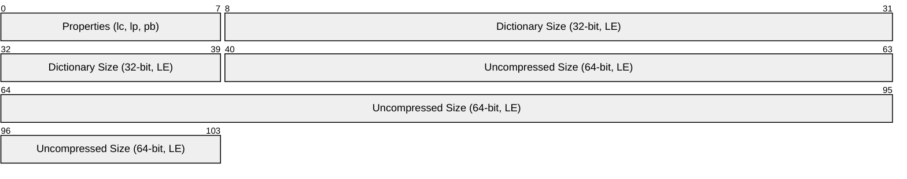
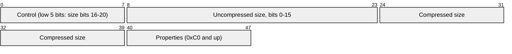

<div align="center">

<h1>lzma1</h1>

A TypeScript implementation of the Lempel-Ziv-Markov chain algorithm (LZMA)
for the `.lzma` format, ported from [XZ for Java][xz-java]. It also decodes
the raw LZMA1 and LZMA2 data inside 7z archives and `.xz` files. It started
as a [fork][fork-link] of [Nathan Rugg's][fork-author] LZMA-JS package.

</div>

[xz-java]: https://github.com/tukaani-project/xz-java
[fork-link]: https://github.com/LZMA-JS/LZMA-JS
[fork-author]: https://github.com/nmrugg

## Why

There are many LZMA implementations in JavaScript, but most are outdated,
unmaintained, lack type support, or rely on specific runtime APIs (e.g.,
Node.js `Buffer`).

This version is a port of XZ for Java, a clean implementation of LZMA by Lasse
Collin and Igor Pavlov, with some optimizations from the LZMA SDK. It is
compatible with `xz --format=lzma`, 7-Zip and the LZMA SDK, and uses only web
standard APIs.

## Features

- Encode and decode `.lzma` data, interoperable with `xz`, 7-Zip and LZMA SDK
- Decode raw LZMA1 and LZMA2 data, as 7z and `.xz` store it, given the
  properties from the container
- Strings (UTF-8) and binary data (`ArrayBuffer` or any typed array)
- Async compression and decompression with an awaited progress callback,
  for yielding, progress and cancellation
- Compression levels 1-9 or fine-grained options (dictionary size,
  `lc`/`lp`/`pb`, ...)
- Web Streams (`TransformStream`) for compressing and decompressing streams
- Errors on truncated input and on most corrupted input
- A memory limit for untrusted raw data, in KiB like XZ for Java's
- An optional output size limit, to defend against "decompression bomb" attacks
- No dependencies, runs in browsers, workers, Node.js, Deno and Bun

## Installation

> [!NOTE]
> This package is native [ESM][mozzila-esm] and no longer provides a CommonJS
> export. If your project uses CommonJS, you will have to convert to ESM or use
> the dynamic [`import()`][mozzila-import] function.

[mozzila-esm]: https://developer.mozilla.org/en-US/docs/Web/JavaScript/Guide/Modules
[mozzila-import]: https://developer.mozilla.org/en-US/docs/Web/JavaScript/Reference/Operators/import

### [npm](https://npmjs.com/lzma1)

```sh
npm install lzma1
```

### browser

```html
<script type="module">
	import {
		compress,
		compressString,
		decompress,
		decompressString,
	} from "https://esm.sh/lzma1@latest";
</script>
```

## Quick start

Six functions compress and decompress the `.lzma` format, and three decode
raw data:

```ts
// For binary data
compress(data: ArrayBuffer | ArrayBufferView, mode?: 1-9 | CompressionOptions): Uint8Array
compressAsync(data: ArrayBuffer | ArrayBufferView, mode?: 1-9 | CompressAsyncOptions): Promise<Uint8Array>
decompress(data: ArrayBuffer | ArrayBufferView, options?: DecompressionOptions): Uint8Array
decompressAsync(data: ArrayBuffer | ArrayBufferView, options?: DecompressAsyncOptions): Promise<Uint8Array>

// For string data
compressString(data: string, mode?: 1-9 | CompressionOptions): Uint8Array
decompressString(data: ArrayBuffer | ArrayBufferView, options?: DecompressionOptions): string

// For raw data without a .lzma header, e.g. from 7z or .xz
decompressRawLzma1(data: ArrayBuffer | ArrayBufferView, options: RawLzma1Options): Uint8Array
decompressRawLzma1Async(data: ArrayBuffer | ArrayBufferView, options: RawLzma1AsyncOptions): Promise<Uint8Array>
decompressRawLzma2(data: ArrayBuffer | ArrayBufferView, options: RawLzma2Options): Uint8Array
```

The `Async` functions return the same bytes as the functions without the
suffix, and await an optional `onProgressAsync` callback while they work, so
that the caller can yield to the event loop, show progress or cancel. The
callback's doc comment has an example. Important: the caller can read `data`
but must not modify it until the returned promise has settled.

Strings are encoded as UTF-8. `decompressString` also decodes data compressed
by v0.3.0 and older, which used Java's "modified UTF-8". The `LZMA` class
from v0.2.0 is exported again; its `decompress` now returns a `Uint8Array`.

### Compressing a string

```js
import {
	compressString,
	decompressString,
} from "lzma1";

const data = "Hello World!";
const compressed = compressString(data, 1); // level 1 (fastest)
const decompressed = decompressString(compressed);

// data === decompressed
```

### Working with binary data

```js
import {
	compress,
	decompress,
} from "lzma1";

const binaryData = new Uint8Array([0x01, 0x02, 0x03, 0x04]);
const compressed = compress(binaryData, 5); // default level
const decompressed = decompress(compressed);
```

### Compression options

The level (1-9, default 5) trades speed for size:

| Level | Encoder | Match finder | Dictionary |
| ----- | ------- | ------------ | ---------- |
| 1     | fast    | hc4          | 1 MiB      |
| 2     | fast    | hc4          | 2 MiB      |
| 3     | fast    | hc4          | 4 MiB      |
| 4     | normal  | bt4          | 1 MiB      |
| 5     | normal  | bt4          | 2 MiB      |
| 6     | normal  | bt4          | 4 MiB      |
| 7     | normal  | bt4          | 8 MiB      |
| 8     | normal  | bt4          | 16 MiB     |
| 9     | normal  | bt4          | 32 MiB     |

Instead of a level, pass options. Options not given come from the level.

```js
const compressed = compress(data, {
	level: 9, // preset 1-9
	dictSize: 1 << 20, // dictionary size in bytes, 4 KiB - 768 MiB
	lc: 3, // literal context bits, 0-4
	lp: 0, // literal position bits, 0-4, lc + lp <= 4
	pb: 2, // position bits, 0-4
	mode: "normal", // "fast" or "normal" (optimal parsing)
	niceLen: 64, // match length that is good enough, 8-273
	matchFinder: "bt4", // "hc4" (hash chain) or "bt4" (binary tree)
	depth: 0, // match finder search depth, 0 = automatic
	endMarker: true, // false omits the end marker, see below
});
```

A dictionary larger than the input is reduced to fit it, which saves memory
when compressing and decompressing. Data with `lc + lp > 4` from other
encoders (e.g. 7-Zip) can still be decompressed.

The header holds the uncompressed size, so the end marker after the data is
redundant for decoders that read it. `endMarker: false` omits it, like XZ for
Java and 7-Zip without `-eos`, and saves 5-6 bytes, which matters for small
payloads such as QR codes. Decoders that don't know the size need the marker to
find the end: raw LZMA decoders (`xz --format=raw`, Python's `FORMAT_RAW`)
report an error or decode past the end without it. Omit it only when the data
is decoded with its header (this library, `xz --format=lzma`, 7-Zip) or the
size is known from elsewhere. Strict decoders that know the size may reject a
marker, e.g. XZ for Java's raw `LZMAInputStream` constructor without
`enableRelaxedEndCondition()`.

### Raw LZMA1 and LZMA2

7z archives and `.xz` files store LZMA data without the `.lzma` header and keep
its properties in their own headers. Pass those properties to
`decompressRawLzma1` or `decompressRawLzma2`. This library doesn't parse the 7z
or `.xz` containers.

```js
import {
	decompressRawLzma1,
	decompressRawLzma2,
} from "lzma1";

// A 7z LZMA entry. Its 5-byte coder properties are the byte
// (pb * 5 + lp) * 9 + lc and the dictionary size, 32-bit little-endian.
const file = decompressRawLzma1(packed, {
	lc: 3, // literal context bits, 0-8
	lp: 0, // literal position bits, 0-4
	pb: 2, // position bits, 0-4
	dictSize: 1 << 24, // dictionary size in bytes
	uncompressedSize: 123_456, // optional, the size from the 7z header
	memoryLimitKb: 65_536, // optional
});

// LZMA2 data from a 7z entry or an .xz block
const block = decompressRawLzma2(packed, {
	dictSize: 1 << 20, // from the LZMA2 properties byte, see "LZMA2" below
	memoryLimitKb: 65_536, // optional
});
```

LZMA2 marks its own end and needs no size. Raw LZMA1 needs the uncompressed
size or an end marker. 7-Zip writes no end
marker by default, so pass the size from the 7z header.
`xz --format=raw --lzma1` always writes one. With a known size, the data has to
end there, with or without an end marker, as with `decompress`. An end marker
before that size is an error, as with `strict`.

The dictionary size comes from the container, and a corrupt or hostile header
can claim up to 4 GiB. `memoryLimitKb` works like XZ for Java's `memoryLimit`.
The decoder estimates its memory in KiB from the dictionary size, plus `lc` and
`lp` for LZMA1, and throws a `MemoryLimitError` before it allocates anything if
the estimate is over the limit. The error's `memoryNeededKb` and `memoryLimitKb` fields hold
both numbers. The estimate counts the dictionary at the size given. The
dictionary buffer starts at 64 KiB at most and doubles only as output arrives,
so a huge claimed dictionary costs nothing until the output grows. A known LZMA1
size changes that: `decompressRawLzma1` then allocates up to 64 MiB at once from
it, for the dictionary or for the output, as `decompress` does with the size in
the `.lzma` header. The estimate doesn't count the output.

### Streams

`Compress` and `Decompress` are `TransformStream`s, used like the built-in
`CompressionStream`:

```js
import {
	Compress,
	Decompress,
} from "lzma1";

// Compress a file
const compressed = file.stream().pipeThrough(new Compress(5));

// Decompress a download
const response = await fetch("/data.lzma");
const text = await new Response(response.body.pipeThrough(new Decompress())).text();
```

A stream's size isn't known in advance, so the header marks it as unknown and
the data always ends with an end marker: `new Compress({ endMarker: false })`
throws a `RangeError`.

`DecompressRawLzma1` and `DecompressRawLzma2` decode raw data in a stream and
take the same options as the functions. Invalid options and a dictionary over
the memory limit throw from the constructor.

```js
const output = response.body.pipeThrough(new DecompressRawLzma2({ dictSize: 1 << 20 }));
```

In TypeScript, their types need `TransformStream` from the `DOM` lib or
`@types/node` (or `skipLibCheck`).

### Errors

Decompressing truncated or corrupted data throws an `Error`, e.g.
`"Truncated input"` or `"Corrupted input: match distance is too large"`.
The `.lzma` format has no checksum, so some corrupted data decodes without
an error to different output. Raw LZMA1 and LZMA2 data have none either; 7z
and `.xz` keep their checksums in the container.
Invalid options throw a `RangeError`, and a dictionary over `memoryLimitKb`
throws a `MemoryLimitError`.

The data has to end at the size in the header, with or without an end marker
after it. An end marker before that size ends the data too, because some
producers write a size that is too large. `strict` rejects it, as XZ for Java
and xz do:

```js
decompress(data, { strict: true });
new Decompress({ strict: true });
```

When decompressing data from an untrusted source, `maxOutputLength` can defend
against a "decompression bomb" attack, where a few bytes of crafted data expand
to gigabytes. It limits the output in bytes, for every decoder except raw LZMA2.
With `strict`, and for raw LZMA1, a larger declared size throws an
`OutputLimitError` before anything is allocated. Otherwise, as with an unknown
size, decoding throws one once the output passes the limit, since an end marker
could still end the data within it:

```js
decompress(data, { maxOutputLength: 1_000_000 });
```

### HTML example

```html
<!DOCTYPE html>
<html>
	<body>
		<textarea id="input">Hello World!</textarea><br />
		<button id="run">Compress & Decompress</button>
		<div id="result"></div>

		<script type="module">
			import { compressString, decompressString } from "https://esm.sh/lzma1@latest";

			document.getElementById("run").onclick = () => {
				const text = document.getElementById("input").value;
				const compressed = compressString(text);
				const decompressed = decompressString(compressed);

				document.getElementById("result").innerHTML =
					`Original: ${text.length} bytes<br>` +
					`Compressed: ${compressed.length} bytes<br>` +
					`Result: ${decompressed}`;
			};
		</script>
	</body>
</html>
```

## How it works

LZMA (Lempel-Ziv-Markov chain Algorithm) is a compression algorithm that
combines a dictionary (LZ77-style) compressor with a range coder. It's known
for its high compression ratio and is used in the 7z and xz formats.

### LZMA header

The `.lzma` data starts with a 13-byte header, followed by the compressed data:



The first byte is `(pb * 5 + lp) * 9 + lc`. An uncompressed size of all `0xFF`
bytes means unknown. More [information][header_link] about the LZMA header
structure.

[header_link]: https://docs.fileformat.com/compression/lzma/#lzma-header

### LZMA2

LZMA2 splits the data into chunks of up to 2 MiB uncompressed and 64 KiB
compressed. Every chunk starts with a control byte:

| Control   | Chunk                                                     |
| --------- | --------------------------------------------------------- |
| 0x00      | End of the data                                           |
| 0x01      | Uncompressed, resets the dictionary                       |
| 0x02      | Uncompressed                                              |
| 0x80-0x9F | LZMA                                                      |
| 0xA0-0xBF | LZMA, resets the state                                    |
| 0xC0-0xDF | LZMA, resets the state, new `lc`/`lp`/`pb`                |
| 0xE0-0xFF | LZMA, resets the dictionary and state, new `lc`/`lp`/`pb` |

An uncompressed chunk has its size minus one in the next 2 bytes. An LZMA
chunk has this header, with sizes minus one, big-endian:



The first chunk has to reset the dictionary, and `lc + lp` can't exceed 4.
7z and `.xz` store the dictionary size in one byte `n`. The size is
`0xFFFFFFFF` for `n = 40` and `(2 | (n & 1)) * 2 ** ((n >> 1) + 11)` below
that, from 4 KiB up.

### Benchmarks

See [docs/benchmarks.md](docs/benchmarks.md), and [bench](bench) to run them.

## Verification

The encoder's output is byte-identical to [XZ for Java][xz-java] at commit
[`6925f81`](https://github.com/tukaani-project/xz-java/commit/6925f81244a99d0ea4f3fd021938e2ee1e6de2eb)
on a corpus of inputs and encoder settings. The decoder handles a set of
corrupted streams the same way, except for two documented kinds of corrupt
input that it accepts where XZ for Java rejects them. The raw LZMA1 and LZMA2
decoders handle their own set of streams exactly as XZ for Java does. CI checks
all three.
[fixtures/README.md](fixtures/README.md) describes the corpus and how to
regenerate it.

Passing tests aren't enough for this code. An encoder decision that differs from
XZ for Java's usually still produces a valid stream that decompresses correctly,
so round-trip tests miss it, and the code, though small, has an enormous input
space, many edge cases and modular arithmetic for such differences to hide in.
So every change to the coders comes with a written argument in
[docs/verification.md](docs/verification.md): either that behavior is unchanged
for all inputs, or a documented deviation from the Java code. The identity tests
check those arguments on the corpus.

To run the checks yourself: `bun test src/xz-java-identity_test.ts`, or
`node fixtures/verify.ts` (Node >= 22.18) to run them on V8.

## Related

- [XZ for Java](https://github.com/tukaani-project/xz-java) - the implementation this library is ported from
- [LZMA SDK](https://www.7-zip.org/sdk.html) - the reference implementation by Igor Pavlov
- [XZ Utils](https://github.com/tukaani-project/xz) - `xz` and liblzma
- [LZMA-JS](https://github.com/LZMA-JS/LZMA-JS) - the original JavaScript implementation
- [lzma-purejs](https://github.com/cscott/lzma-purejs)
- [lzmajs](https://github.com/glinscott/lzmajs)
